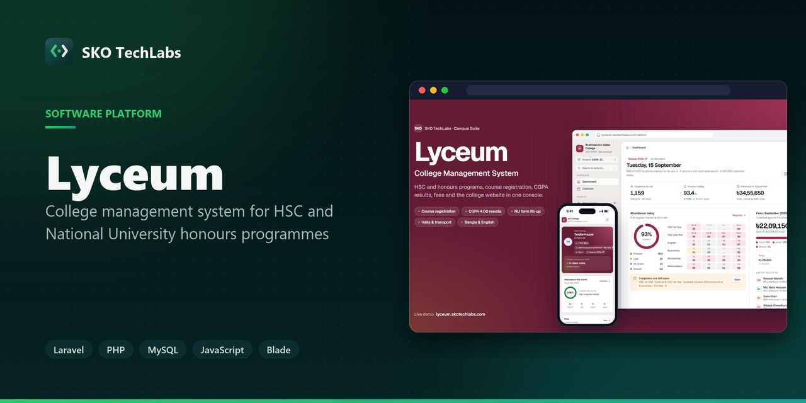
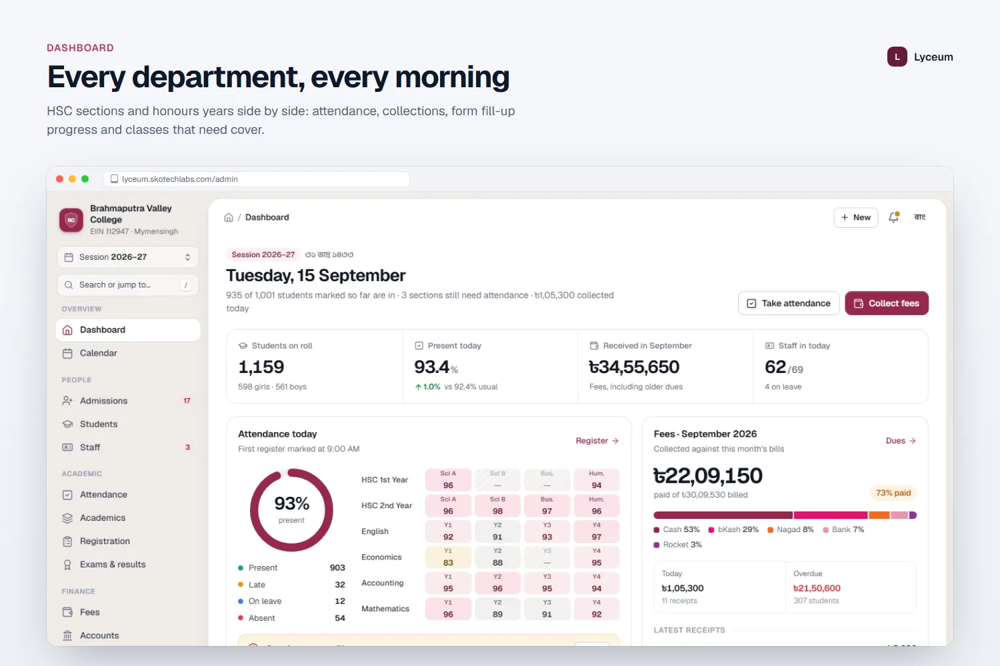
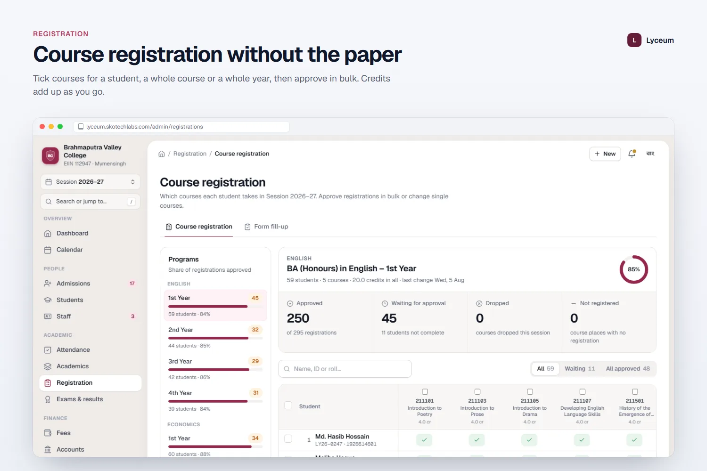
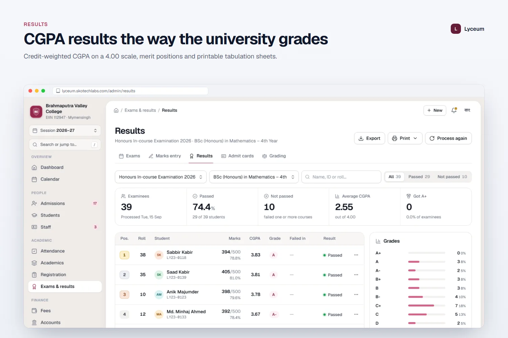
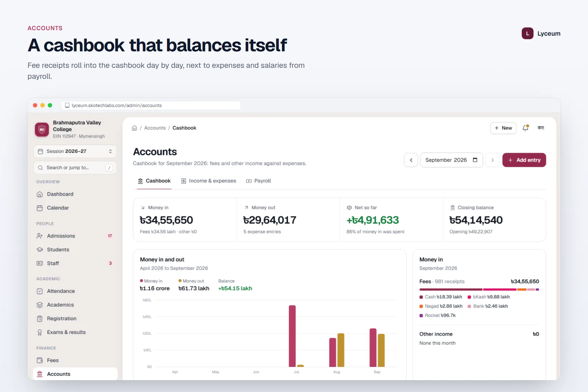
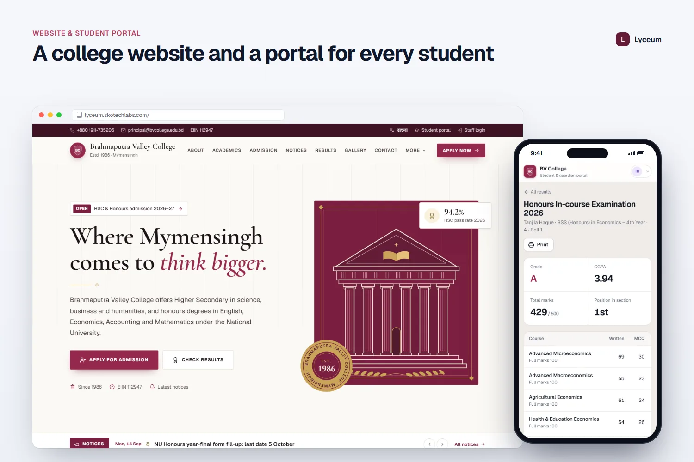

<h3>College management system for HSC and National University honours programmes</h3>

A college management system for HSC and National University honours programmes: departments, courses with credits, course registration, form fill-up, GPA and CGPA results, fees, halls, transport, payroll, a college website and a student portal, all from one admin dashboard.

   

<a href="https://lyceum.skotechlabs.com"><b>Live Demo</b></a> &nbsp;·&nbsp; <a href="https://skotechlabs.com/projects/lyceum-college-management-system"><b>Case Study</b></a> &nbsp;·&nbsp; <a href="https://skotechlabs.com/contact"><b>Request a Demo</b></a> &nbsp;·&nbsp; <a href="https://github.com/skotechlabs"><b>All Products</b></a>

---

## Overview

Lyceum brings a college's departments onto one dashboard. The principal sees attendance by department and year, fee collection, form fill-up progress for the National University examination, results, notices and events, while each department manages its own courses, routine and students.

Honours programmes use course codes and credits. Students register for their courses, the office approves registrations in bulk, and form fill-up for year-final examinations is tracked from application to fee payment and approval. Results are calculated in CGPA 4.00 for honours and GPA 5.00 for HSC groups, with tabulation sheets and transcripts ready to print.

The accounts office generates tuition, session and hall fees, collects payments with bKash references, follows dues by department and runs payroll for faculty and staff. Residential halls, college buses and the library are managed alongside.

A college website with notices, results lookup and admission information, a mobile-first student portal, SMS broadcasts, reports and role-based access for the principal, registrar, accountant and faculty complete the platform.

<table>
<tr>
<td width="50%" valign="top">

### The Challenge

Colleges run HSC and honours side by side with different grading, credit-based courses, National University form fill-up deadlines and hundreds of students per department. Registrars chase registrations on paper, departments keep their own spreadsheets and the principal waits days for a clear picture of fees, attendance and results.

</td>
<td width="50%" valign="top">

### Our Solution

We built the college edition of the Campus Suite engine with departments and years as first-class structure, course codes and credits, both GPA and CGPA grading and a registration and form fill-up workflow. A burgundy and old-gold design gives the college a distinct identity, while the shared engine keeps attendance, fees, results, the website and the portal connected.

</td>
</tr>
</table>

## Key Features

- Principal dashboard: attendance by department and year, fees, form fill-up progress, results and events
- Departments, HSC groups and honours programmes with course codes, credits and subject teachers
- Course registration with bulk approval and National University form fill-up tracking
- CGPA 4.00 results for honours and GPA 5.00 for HSC, merit lists, tabulation sheets and transcripts
- Tuition, session and hall fees with a collection desk, receipts, dues by department and cashbook
- Faculty and staff profiles, attendance, leave and payroll with salary slips
- Residential halls, college bus routes and a library with issues and fines
- Admissions, class routine, attendance with SMS, ID cards and testimonials
- College website, notices, results lookup, student portal, roles and activity log
- Reports for student strength, attendance shortfall, result analysis, fee collection and income and expense
- Full Bangla and English interface with Bangla digits and the Bangla calendar

## Business Impact

- Course registrations approved per department in minutes
- Form fill-up status visible for every eligible student before the deadline
- HSC GPA and honours CGPA results processed from the same marks entry
- Dues and collections reported by department and year
- Students see routine, results and fees on their phones

## Screenshots

<table>
<tr>
<td width="50%" valign="top"> Every department, every morning</td>
<td width="50%" valign="top"> Course registration without the paper</td>
</tr>
<tr>
<td width="50%" valign="top"> CGPA results the way the university grades</td>
<td width="50%" valign="top"> A cashbook that balances itself</td>
</tr>
<tr>
<td width="50%" valign="top"> A college website and a portal for every student</td>
<td width="50%"></td>
</tr>
</table>

> See it running: **[lyceum.skotechlabs.com](https://lyceum.skotechlabs.com)**

## Technology Stack

## Source Code & Licensing

This repository is the public showcase for **Lyceum**. The production source code is proprietary and is maintained privately by SKO TechLabs.

Interested in this product for your business? We offer:

- **Ready-to-launch deployment** of Lyceum under your own brand and domain
- **Customisation** of features, workflows, languages and integrations to fit how you work
- **Custom development** of a new product built on the same foundations
- **Ongoing support**, hosting, maintenance and feature roll-outs after launch

## Get in Touch

---

© 2026 <a href="https://skotechlabs.com">SKO TechLabs</a> · Dhaka, Bangladesh · Building intelligent digital solutions

